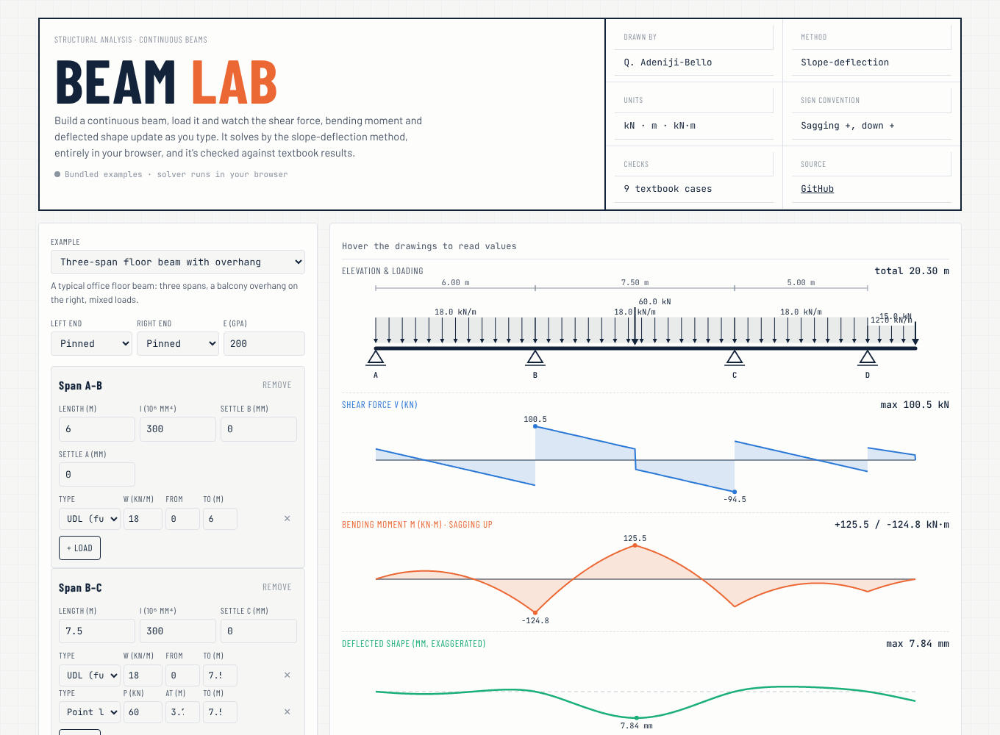
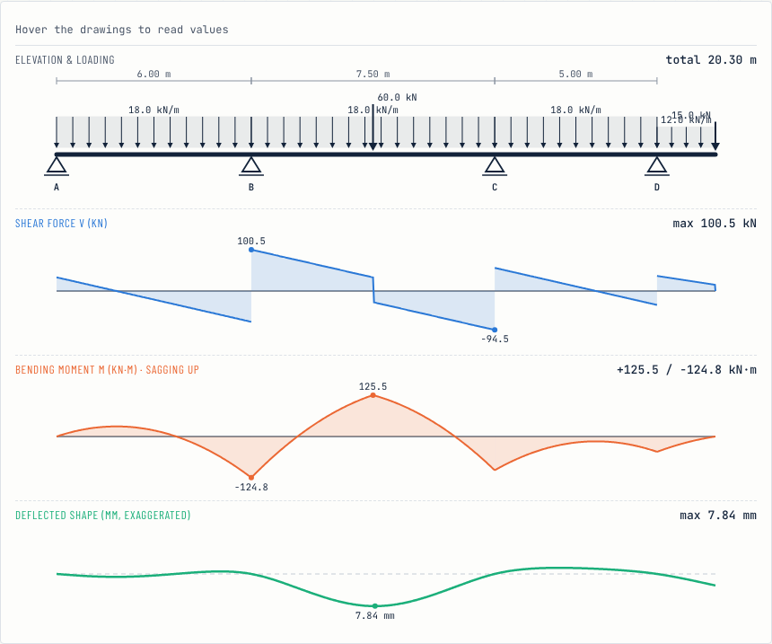

# Beam Lab: continuous-beam analysis by the slope-deflection method

**Build a continuous beam, load it, and watch the shear force, bending moment and deflected shape update as you type.**
The solver runs entirely in the browser and is checked against textbook results by a Python reference implementation and an automated test suite.

**[Open Beam Lab →](https://qaisbello.github.io/engineering/beam-lab/)** · example beams load from [`examples/presets.json`](examples/presets.json) in this repo



## What it does

- **Any number of spans**, each with its own length and second moment of area, plus optional **cantilever overhangs** at either end.
- **End supports** fixed or pinned; interior supports pinned. **Support settlements** in millimetres.
- **Loads:** full or partial UDLs, point loads and triangular loads, combined freely on any span or overhang.
- **Outputs:** reactions, member end moments, rotations, shear-force, bending-moment and deflection diagrams with a shared hover readout, and a serviceability check against span/360.
- **Show the working:** the fixed-end moments, every slope-deflection equation, the joint equilibrium equations and the solved rotations, written out for the beam on screen.



## How it works

For each span *i–j* with length *L* and flexural rigidity *EI*:

```
M_ij = FEM_ij + (2EI/L)(2θi + θj − 3ψ)        ψ = (Δj − Δi)/L
M_ji = FEM_ji + (2EI/L)(2θj + θi − 3ψ)
```

Every support that can rotate contributes one equilibrium equation (Σ end moments = 0, with overhang moments as constants). The linear system is solved for the rotations. End moments, reactions and diagrams then follow from statics, and deflections come from integrating M/EI along each span. Distributed loads are integrated numerically, so any load shape gets exact fixed-end moments without a lookup table.

## Tested against textbook results

| Case | Expected | Solver |
|---|---|---|
| Fixed-fixed beam, UDL | M = wL²/12 at the ends, wL²/24 at midspan | ✓ |
| Propped cantilever, UDL | M = wL²/8, reactions 5wL/8 and 3wL/8 | ✓ |
| Two equal spans, UDL | M_B = wL²/8, reactions 3/8, 10/8, 3/8 × wL | ✓ |
| Simply supported, central point load | M = PL/4, δ = PL³/48EI | ✓ |
| Fixed-fixed, support settlement Δ | M = 6EIΔ/L² | ✓ |
| Fixed-fixed, off-centre point load | M = Pab²/L², Pa²b/L² | ✓ |
| Fixed-fixed, triangular load | M = wL²/30, wL²/20 | ✓ |
| Overhang with tip load | Uplift −Pc/L at the far support, δ_tip = Pc²(L+c)/3EI | ✓ |

`pytest tests/` checks the Python reference and `node tests/parity.js` checks that the browser solver gives the same answers. Both run on every push.

## Version 1 → version 2

The first version (kept in [`legacy/`](legacy/)) was a Flask + SymPy app. Writing these tests exposed **three bugs** in it. Point-load positions were ignored, one fixed-end moment had the wrong sign, and pinned ends dropped the carry-over term (it under-reported a textbook support moment by a third). The full write-up is in [`docs/v1-bugs.md`](docs/v1-bugs.md). Version 2 fixes all three, needs no server, and removes the committed virtual environment.

## Skills shown

Structural analysis (slope-deflection, statics, beam deflection) · numerical methods (linear systems, numerical integration) · Python (NumPy) · JavaScript · test-driven verification and CI · interactive engineering visualisation (D3.js) · finding and documenting bugs in my own earlier work

## Repo layout

```
beam/solver.py            Python reference solver
web/beam.js               browser solver (same algorithm)
web/template.html         Beam Lab interface
web/index.html            built single-file app (python build.py)
examples/presets.json     example beams loaded by the app
tests/test_solver.py      textbook checks (pytest)
tests/parity.js           browser-solver checks (node)
docs/v1-bugs.md           what was wrong in version 1
legacy/                   version 1 (Flask + SymPy), unchanged apart from removing env/
```

## Run it

```bash
python build.py                  # builds web/index.html
python -m http.server            # then open http://localhost:8000/web/
pip install -r requirements.txt pytest && pytest -q tests
node tests/parity.js
```

## Limits

Linear-elastic, prismatic spans, small deflections, and no shear deformation. Interior supports are pinned (no interior fixity or hinges yet). It's a checking and teaching tool, not a substitute for a design-code check.

---
Built by **Qais Adeniji-Bello** (B.Sc. Building Construction Technology, University of Lagos) · [qaisbello.github.io](https://qaisbello.github.io) · [LinkedIn](https://www.linkedin.com/in/qais-adeniji-bello/)
